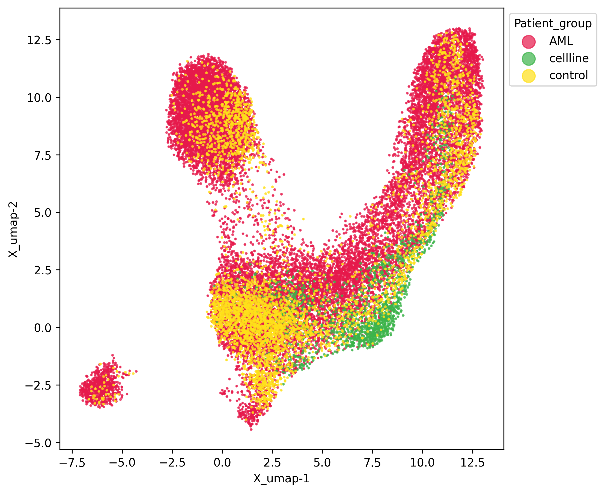
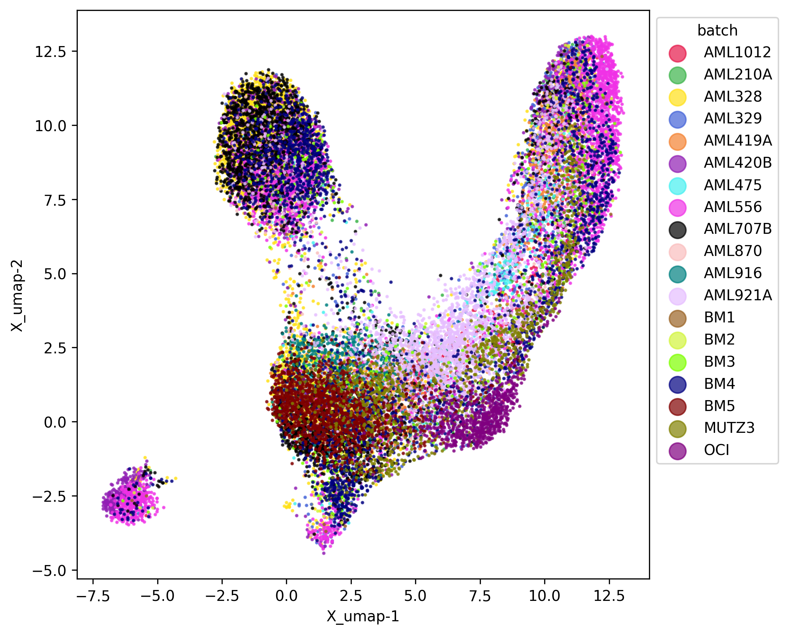
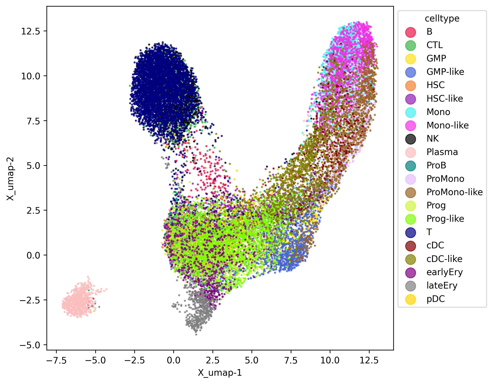
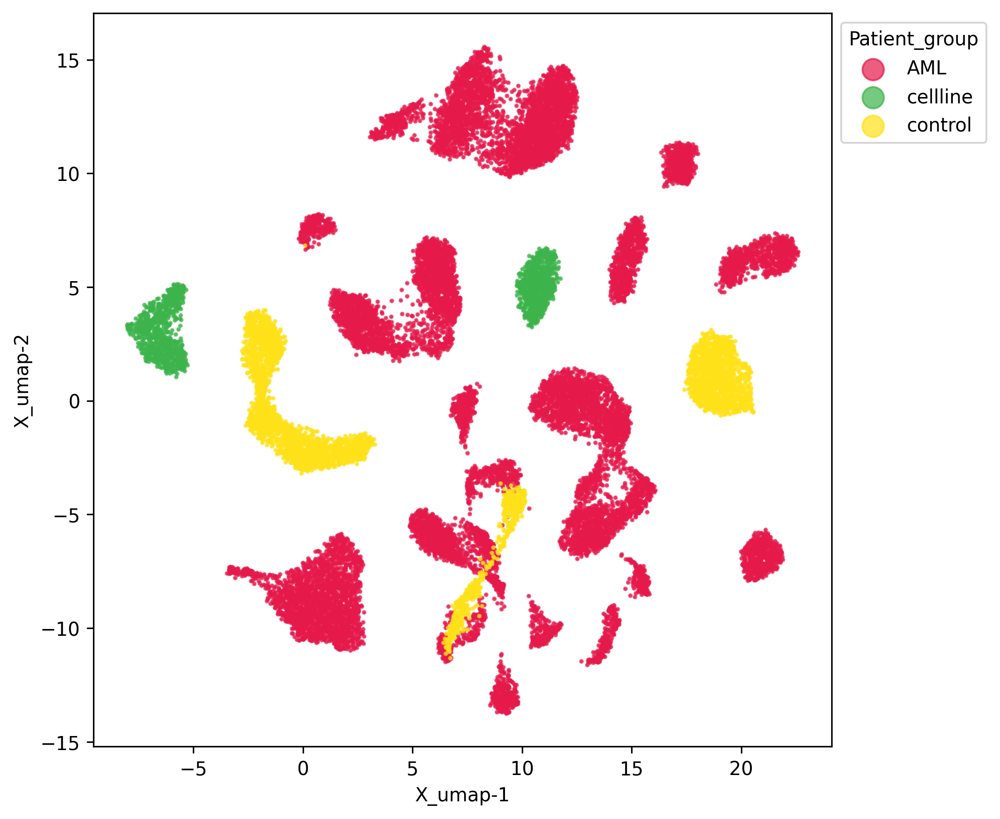
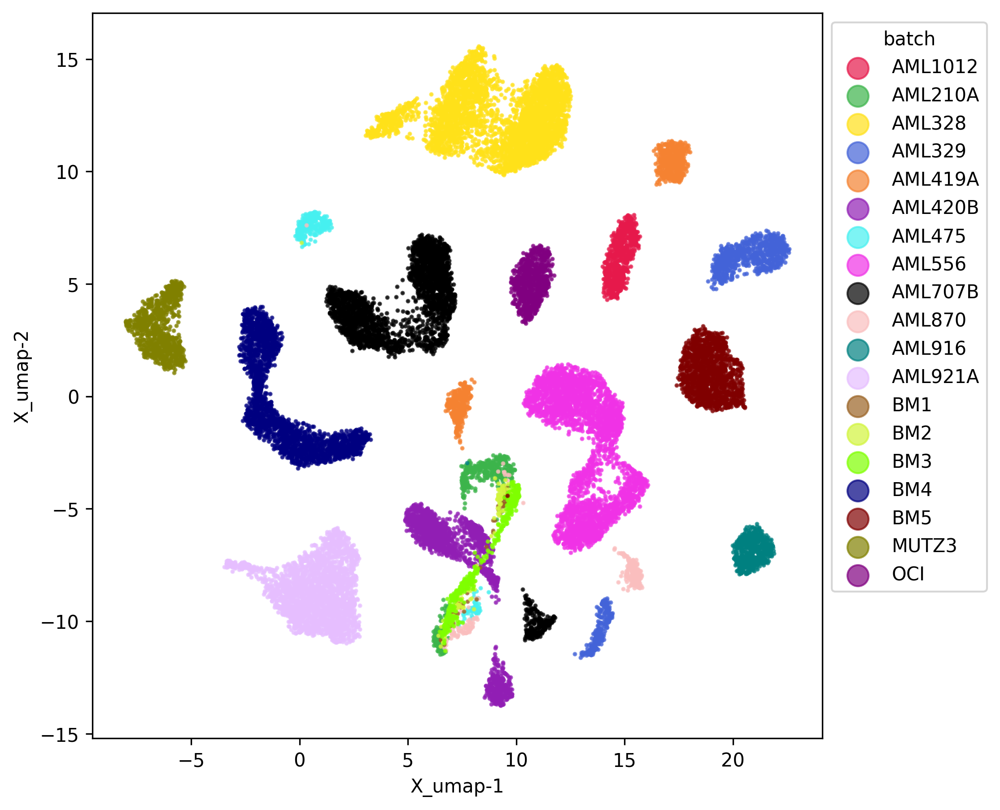
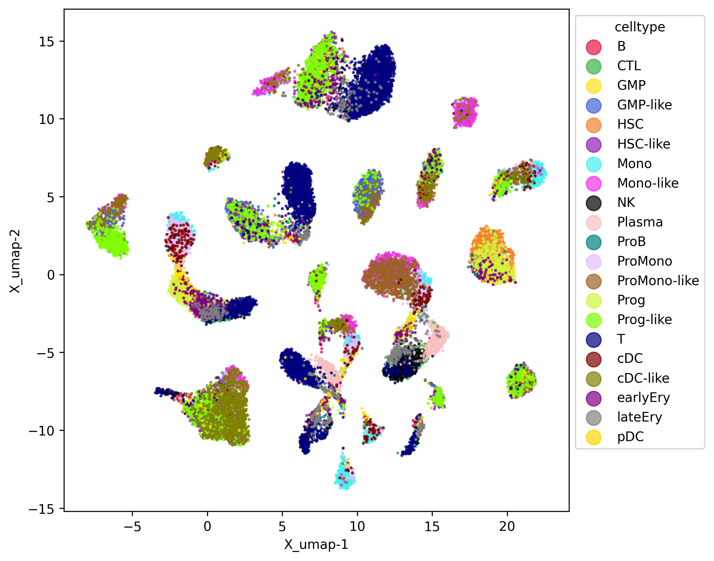

# 阶段 3:UMAP

代码见 [script.py](script.py)。

## 在做什么

把两个模型的 50 维潜在表示用 UMAP 降到 2 维,每个模型出 3 张图,分别按 `Patient_group`(患者组)、`batch`(批次)、`celltype`(细胞类型)上色。图在 `results/`:

| | Patient_group | batch | celltype |
|---|---|---|---|
| FE |  |  |  |
| RE |  |  |  |

## 怎么读

- **FE**:点连成一整片连续的形状。批次图里不同颜色混在一起,没有按批次分开;细胞类型图里能看到沿着形状的分区(例如 T 细胞、浆细胞各占一块)。
- **RE**:分成很多彼此分开的小团。批次图里每个小团基本是单一颜色,即按批次分团;细胞类型图里同一个小团里颜色混杂。
- 这和阶段 2 的数字一致:RE 的批次分数高,FE 的细胞类型分数更高。

## 注意

- 这些图来自 `AML_demo_mine` 目录,用的是你 00:15/00:16 训练的模型(文件时间 00:33,已核对)。
- 日志里的 `Directory does not exist ... splits_2/3/4/5` 不是错误,quick 模式只训练了第 1 折。
- UMAP 的形状每次运行会略有不同(随机种子、批次抽样),看整体趋势而不是具体形状。
