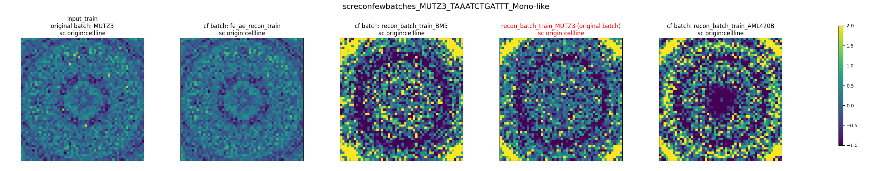

# Stage 4: genomap

Code: [script.py](script.py).

## What it does

genomap arranges the 2,916 gene-expression values of a cell into a 2D "gene image". Here we take Mono / Mono-like cells and place the images of **the same cell** in several states side by side:

1. The original input (`input_train`)
2. The FE reconstruction (`fe_ae_recon_train`)
3. RE reconstructions into different batches (`recon_batch_train_BM5`, `..._MUTZ3`, `..._AML420B`)

The panel with the red title is the cell's original batch (`original batch`); the others, labelled `cf batch`, are reconstructions "as if the cell were in another batch" (cf = counterfactual). The colour range is fixed from -1 to 2.

## Results: `results/genomap_1.png` to `genomap_4.png`

I only examined the first figure carefully (cell `MUTZ3_TAAATCTGATTT_Mono-like`). The other 3 have the same structure and I did not check them one by one:

- Panels 1 and 2 (input and FE reconstruction) look very similar and rather smooth, which means the FE reconstruction largely recovers the input.
- The last 3 panels (RE reconstructed into different batches) have clearly stronger contrast, with large bright-yellow areas at the edges, and the patterns differ between the three batches. This suggests the RE reconstruction contains batch-specific components, so the "look" of gene expression changes when the batch is swapped.
- In other words, RE can "move" the same cell to different batches and reconstruct it, with visible differences between batches. This is an observation of this one figure, not a statistical conclusion.

## Notes

- The log shows that only 1 or 2 matching cells were sampled for each target batch, and messages such as `No cells available ... Skipping batch` appear. 296 more cells were also drawn at random to fill the sample (I did not fully understand what every log line means), so this is a **qualitative** display of a few cells and does not represent the whole dataset.
- `num_iter=200` is the setting the authors label as a "quick test".
- Besides these 4 figures, the output directory contains other plots such as `singlecell_gene_std_acrossbatches/`, which were not examined here.
